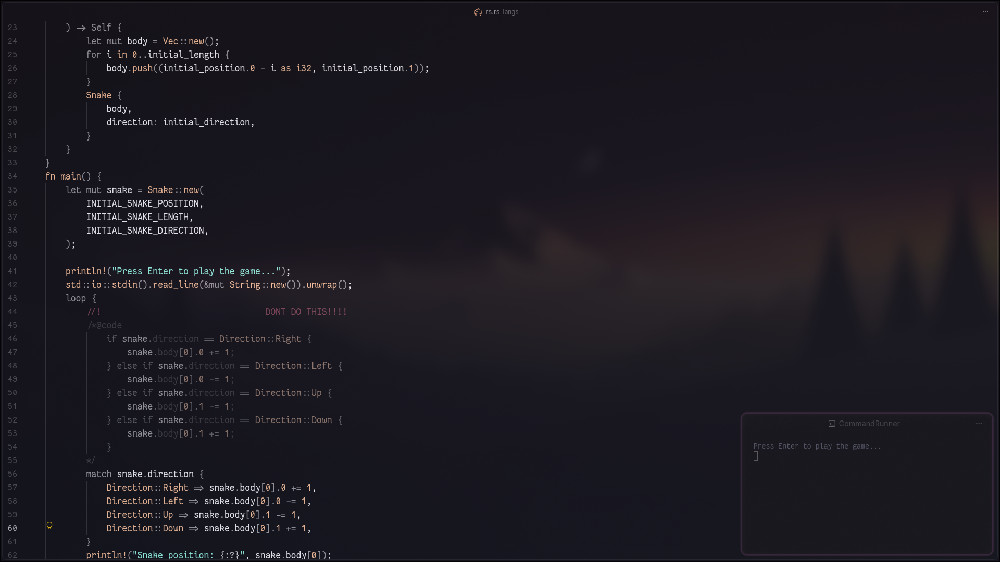

# CodeInComments

CodeInComments is a Visual Studio Code extension that highlights code markers
inside comments while preserving the syntax highlighting of the current file
language. The marked code receives configurable opacity and grayscale effects.



## Supported markers

The extension supports implicit `@code` markers. The language is inferred from
the host file:

```javascript
/*@code
const message = "Hello, world!";
console.log(message);
*/

//@code const enabled = true;
```

The language is inferred from the host file, so markers stay concise and do not
need a language name.

The `$` abbreviation can be enabled with `codeInComments.enableAbbreviations`:

```json
{
	"codeInComments.enableAbbreviations": true
}
```

When enabled, `/*$ ... */`, `//$ ...`, and `#$ ...` are accepted as aliases for
the corresponding implicit `@code` forms.

Syntax highlighting for implicit markers is currently implemented for
JavaScript, JSX, TypeScript, TSX, Rust, Python, Go, and Lua. Support for additional
host languages is pending.
Comments nested inside marked code keep the normal comment color and are not
affected by opacity or grayscale.

## Configuration

### `codeInComments.opacity`

Controls the opacity applied to marked code. The value is between `0` and `1`.
The default is `0.5`.

```json
{
	"codeInComments.opacity": 0.7
}
```

### `codeInComments.grayscale`

Controls the grayscale percentage applied to marked code. The value is between
`0` and `100`. The default is `25`.

```json
{
	"codeInComments.grayscale": 40
}
```

### `codeInComments.preserveNestedComments`

Keeps comments inside highlighted code at their normal color and prevents them
from receiving opacity or grayscale. The default is `true`. Set it to `false`
to apply the effects to the entire highlighted range.

## Development

### Requirements

- VS Code `1.39.0` or newer.
- Node.js and npm.

### Install and run

```bash
npm install
```

Open the project in VS Code and press `F5` to start an Extension Development
Host. Open a JavaScript, JSX, TypeScript, TSX, Rust, Python, Go, or Lua file
containing a supported marker.

### Validate

```bash
python3 -m json.tool package.json > /dev/null
for file in syntaxes/*.json; do python3 -m json.tool "$file" > /dev/null; done
node --check extension.js
npm test
npm run build
```

## Project structure

```text
.
├── .gitignore             # Git ignore rules
├── .vscodeignore          # Extension packaging ignore rules
├── DEVELOPMENT.md         # Development guide and checklist
├── README.md              # Main documentation
├── extension.js           # Entry point
├── marker-ranges.js       # Code range detection logic
├── package.json           # Project configuration and dependencies
├── public/
│   └── example.webp       # Visual example
├── syntaxes/              # TextMate injection grammars
│   ├── comment.message.*.json
└── test/
    ├── langs/             # Language fixtures for testing
    │   └── *.{go,js,jsx,lua,py,rs,ts,tsx}
    └── marker-ranges.test.js # Detector unit tests
```

## Status

The first functional version is implemented. Future versions may add support
for more host languages and automated extension tests.
